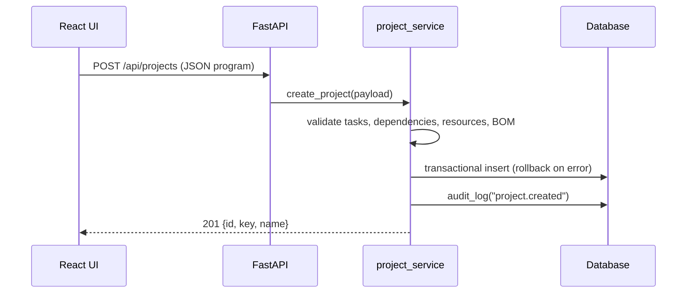
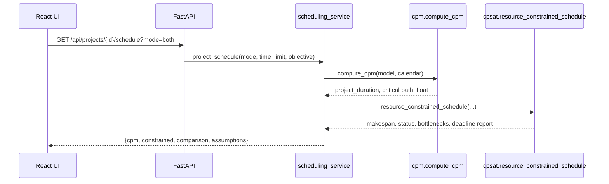
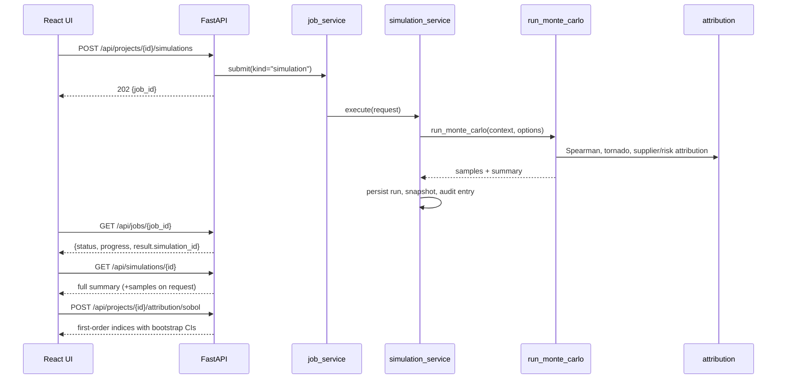
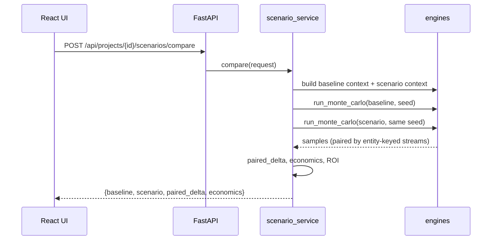
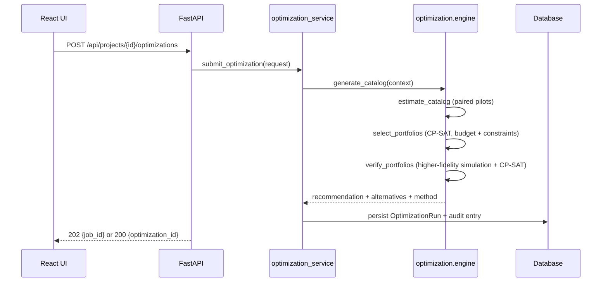
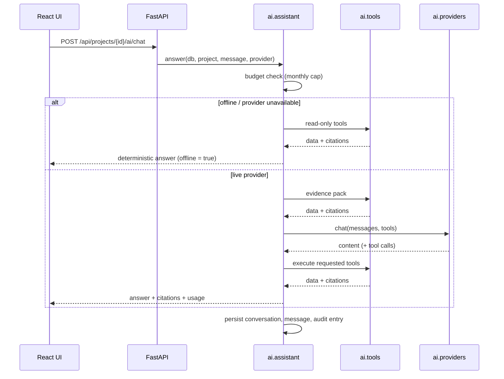

# API data flow

All routes are prefixed with `/api`. Requests carry an `X-Request-ID` header that is
echoed in the response and in the structured logs; errors use the uniform body
`{"code", "message", "details", "request_id"}`.

## Program lifecycle

## Schedule

## Simulation and attribution

## Scenario comparison (common random numbers)

## Optimisation

## AI copilot

