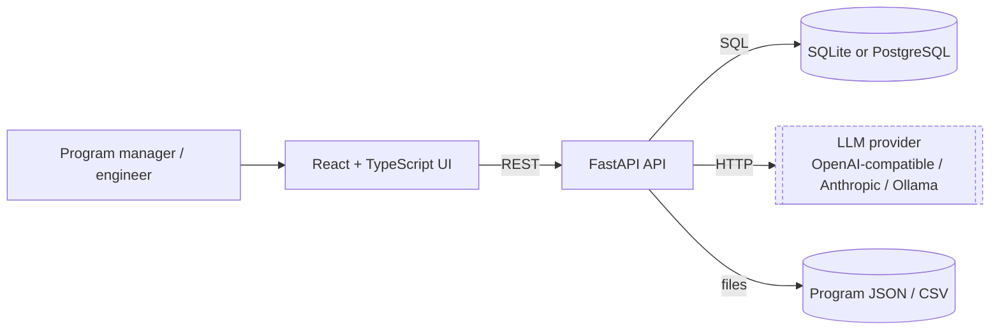
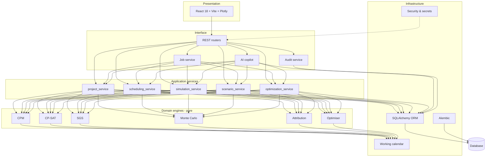
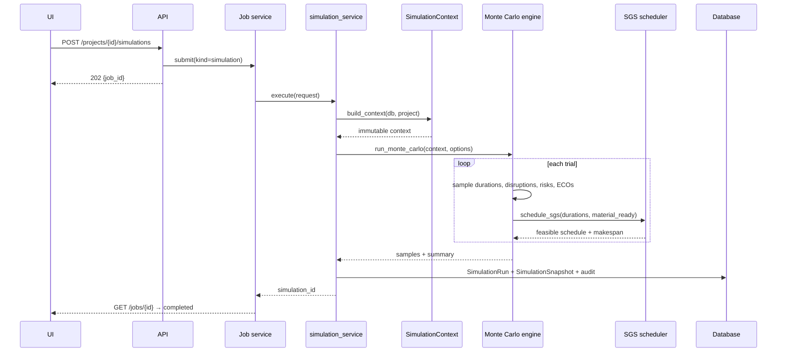
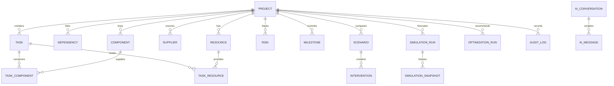

# Architecture diagrams (Mermaid)

## System context



## Layered architecture



## Simulation data flow



## Paired scenario comparison (common random numbers)

```mermaid
flowchart LR
    Seed[seed + entity id] --> StreamA[Random stream per entity]
    Seed --> StreamB[Same streams]
    StreamA --> Base[Baseline arm]
    StreamB --> Scen[Scenario arm]
    Base --> D1[(makespan samples)]
    Scen --> D2[(makespan samples)]
    D1 --> Delta[Paired delta = scen - base]
    D2 --> Delta
    Delta --> Stats[mean, CI95, P(improve), P(harm)]
    Stats --> Econ[Net benefit and ROI]
```

## Optimisation loop

```mermaid
flowchart LR
    Ctx[Program context] --> Cat[Candidate catalog\n14 intervention types]
    Cat --> Pilot[Paired pilot estimates]
    Pilot --> Sel[CP-SAT selection\nbudget, exclusivity, prerequisites]
    Sel --> Ver[Higher-fidelity verification]
    Sel --> Par[Pareto front\n(real CP-SAT solves)]
    Par --> Ver
    Ver --> Rec[Recommendation\nverified net benefit]
    Ver -.->|interactions| Caution[Additive score caveat]
```

## Data model (excerpt)


